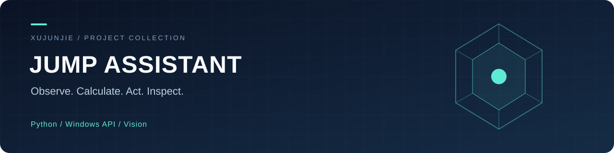
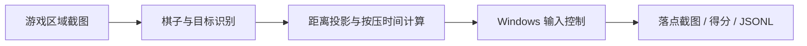

# 跳一跳助手 · Jump Assistant
> 基于 Windows 原生接口的屏幕识别与自动按压实验。

**Python · Windows API · 图像识别 · JSONL 日志 · 无第三方 Python 包**

## 项目概览

在电脑版微信的「跳一跳」窗口中识别棋子和下一平台，计算按压时间并记录跳跃前后的状态。项目把图像观察、时间模型与操作执行拆为独立模块，便于检查识别偏差和校准结果。

## 工作流程



## 实现亮点

- **原生系统调用**：使用 Python 标准库与 Windows 接口，无需 pip 依赖。
- **分层识别**：区分窗口定位、棋子与平台识别，以及得分读取。
- **时间模型**：按窗口宽度归一化距离，并对长按区间使用有界校正。
- **可回溯记录**：保存跳前、跳后截图及请求和实际按压时长，便于复盘。

## 代码导览

| 文件 | 职责 |
| --- | --- |
| [jump.py](jump.py) | 主循环、按压时间模型与运行日志 |
| [jump_game.py](jump_game.py) | 游戏观察、按压和落地状态接口 |
| [jump_vision.py](jump_vision.py) | 视觉识别逻辑 |
| [jump_score.py](jump_score.py) | 得分识别 |
| [jump_native.py](jump_native.py) | Windows 原生能力封装 |
| [启动.bat](启动.bat) | Windows 启动入口 |

## 启动

1. 准备 Windows 与 Python 3.11 或更高版本。
2. 将自己的棋子模板 `piece.png`、分数模板 `jump_score_templates.json` 放到 `启动.bat` 同目录。仓库仅提供源码，未包含这两个运行素材。
3. 打开电脑版微信「跳一跳」，进入游戏并保持窗口完整可见。
4. 双击 `启动.bat`，等待约 3 秒。跳跃间隔按住 F8 停止，或在终端按 Ctrl+C。

也可限制测试跳数：

```powershell
python .\jump.py --steps 5
```

截图和记录保存在 `jump_runs/`。窗口尺寸、显示缩放和游戏版本会影响识别；校准参数集中在 `jump.py`，不能将一台机器上的参数直接视为通用精度保证。

## 许可证

助手源码采用 [MIT License](LICENSE)。游戏、模板素材及其他第三方资源按各自授权使用。
